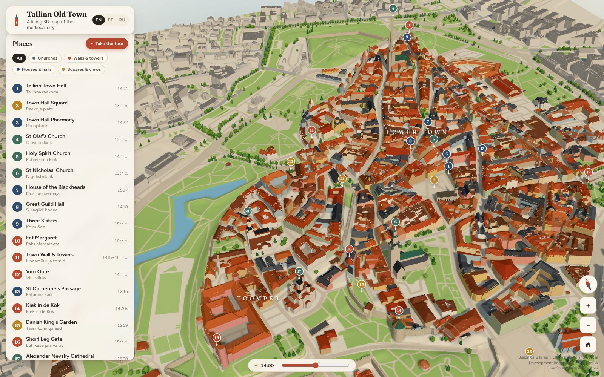
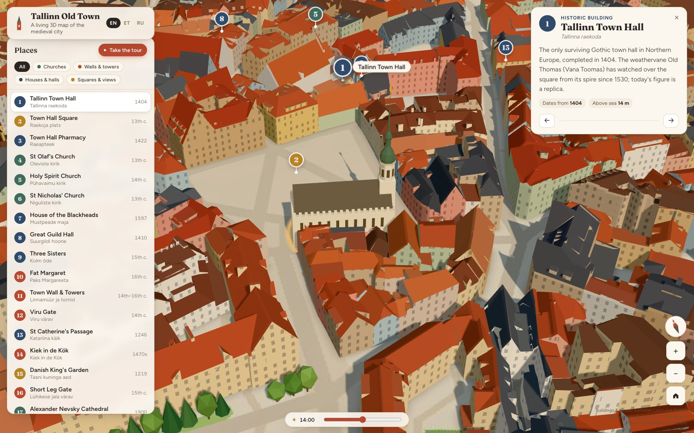
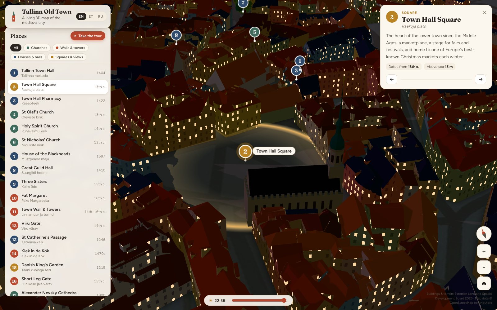
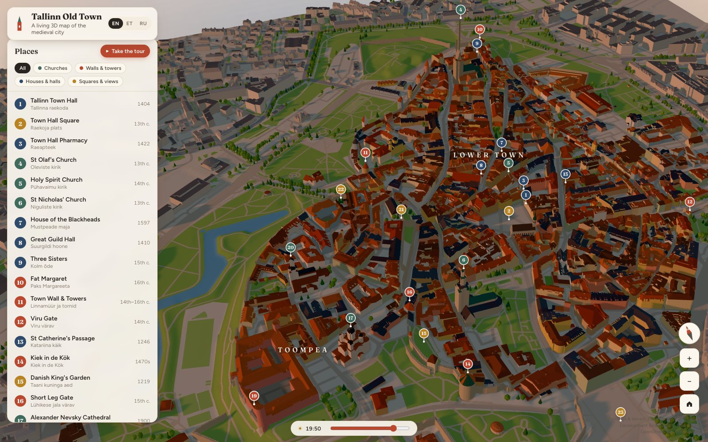
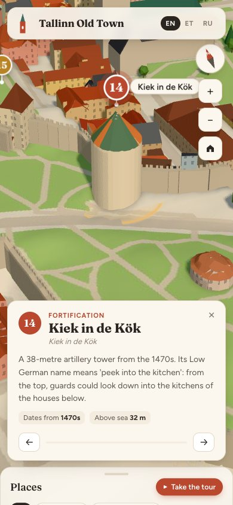

# Tallinn Old Town in 3D

**[▶ Open the live map](https://shishirrijal.github.io/tallinn-3d/)**

An interactive, storybook-style 3D map of Tallinn's medieval Old Town (Vanalinn), a UNESCO World Heritage site. It runs in the browser with nothing to install, works on phones, and is built entirely from open government and community data.



## Why this exists

Tallinn already has a few 3D experiences, but each serves a different audience:

| Existing | What it is | Gap |
|---|---|---|
| [3d.tallinn.ee](https://3d.tallinn.ee) | The city's digital twin | A realistic planning tool, not made for exploring or stories |
| VR Tallinn 1939/44 | A paid, in-person VR headset experience | Not on the web |
| VisitTallinn VR app | 360° videos of 8 spots | Video, not an explorable model |

This project fills the gap between them: **a free, readable, story-driven 3D map that anyone can open from a link.**

## Features

- **The real city, stylized.** About 1,800 buildings with their true roof shapes, standing on a 1 m terrain model. Toompea really is 20–30 m above the Lower Town.
- **23 landmarks with stories** in English, Estonian and Russian. Click a pin or a building to fly there.
- **Guided tour.** One button plays the landmarks in sequence, slowly circling each one while you read.
- **Time of day.** Drag the sun from dawn through golden hour to night, when windows across the town light up.
- **Building info on hover.** Address and height for every building, from the Land Board register.
- **Hand-built landmarks** where the automatic data fails. The Land Board's Town Hall is a flat box, so it is replaced with a procedural model: crenellated parapet, the arcade facing the square, the octagonal tower and Old Thomas on the spire.
- **City walls with battlements**, generated from OpenStreetMap because the Land Board data covers only the towers.
- **Shareable links** to any landmark, e.g. [`#oleviste`](https://shishirrijal.github.io/tallinn-3d/#oleviste).
- **Mobile-first controls.** One finger pans; two fingers zoom and rotate. On phones the list becomes a bottom sheet.

<table>
  <tr>
    <td width="50%"><br><sub>The hand-built Town Hall on Town Hall Square</sub></td>
    <td width="50%"><br><sub>Night mode: lit windows around Town Hall Square</sub></td>
  </tr>
  <tr>
    <td width="50%"><br><sub>Golden hour over Toompea and the Lower Town</sub></td>
    <td width="50%" align="center"><br><sub>Phone layout: Kiek in de Kök</sub></td>
  </tr>
</table>

## How it is made

```
Land Board LOD2 buildings (.gdb) ─┐
Land Board 1 m terrain (.tif) ────┼──▶ tools/build_scene.py ──▶ public/data/* ──▶ Three.js app (src/)
OpenStreetMap (Overpass JSON) ────┘          │
                                             └─ tools/landmark_models.py (hand-built landmarks)
```

**Data pipeline (Python).** `tools/build_scene.py` does the following:
- Clips the Land Board's 49,816 Tallinn buildings to a 1.8 × 1.7 km area.
- Triangulates every roof and wall face and colors it by type. Old Town façades get a pastel palette; roofs are mostly clay tile, with some slate and metal; tall spires get copper.
- Turns the terrain model into a heightmap.
- Paints the ground texture (streets, squares, parks, Snelli pond) from OSM, with soft contact shadows around buildings.
- Extrudes the city walls and places the trees.
- Resolves each landmark's 3D anchor point.

The output is about 4.5 MB in total. Binary files ship gzip-compressed and are decompressed in the browser.

**App (JavaScript).** Vite and Three.js:
- One draw call for all buildings, with fast picking through [three-mesh-bvh](https://github.com/gkjohnson/three-mesh-bvh).
- A custom shader adds windows, hover and selection highlights, and night lighting without any extra geometry.
- The sun's shadow map follows the camera, so shadows stay crisp at every zoom level.

## Run locally

```sh
npm install
npm run dev          # http://localhost:5173
```

Every push to `main` deploys to GitHub Pages through `.github/workflows/deploy.yml`.

## Rebuild the data

The processed data is committed, so this step is only needed to change the scene. Put the raw downloads in `data/raw/`, which is not committed:

| File | Where to get it |
|---|---|
| `gdb/hooned_lod2-Tallinn.gdb` | [Land Board 3D data](https://geoportaal.maaruum.ee/eng/spatial-data/3d-data/download-3d-data-p837.html): Buildings LOD2, Tallinn, gdb |
| `dem/63843_dtm_1m.tif` | [Land Board elevation data](https://geoportaal.maaruum.ee/eng/spatial-data/elevation-data/download-elevation-data-p664.html): DTM 1 m, map sheet 63843 |
| `osm/oldtown.json`, `osm/vanalinn.json` | Overpass API exports (queries described in `tools/build_scene.py`) |

```sh
python3 -m venv tools/.venv
tools/.venv/bin/pip install pyogrio shapely numpy pyproj rasterio pillow mapbox_earcut
npm run data         # regenerates public/data/*
```

Landmark texts live in `tools/landmarks_src.json`. Hand-built models live in `tools/landmark_models.py`.

## Roadmap

- [ ] Hand-model more landmarks: Alexander Nevsky's onion domes, Fat Margaret, Viru Gate
- [ ] A historical time slider: the 1825 town model, then pre-war and post-war Tallinn
- [ ] Audio narration for the tour
- [ ] A treasure hunt mode

## Credits

- Buildings and terrain: © Estonian Land and Spatial Development Board (Maa- ja Ruumiamet) 2026, open data
- Map data: © [OpenStreetMap](https://www.openstreetmap.org/copyright) contributors, ODbL
- Built with [Three.js](https://threejs.org) and [Vite](https://vitejs.dev)
